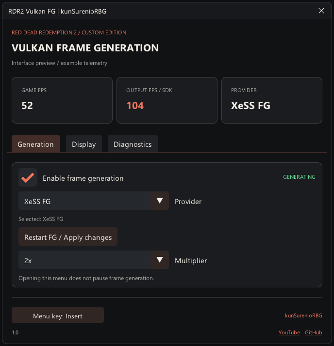

# RDR2-Vulkan-DLSSFG

**Version 1.0.1 · kunSurenioRBG · Red Dead Redemption 2 only**

Frame generation for Red Dead Redemption 2 while the game renders with Vulkan. Version 1.0.1 improves XeSS focus recovery, game input, frame association and output telemetry.

## Features

- Native Vulkan DLSS-G path with matching game inputs.
- XeSS frame generation through the existing internal Vulkan/D3D12 interoperability path.
- CUDA-backed NVIDIA adapter selection to handle certain duplicate DXGI identities.
- Cached XeSS multiplier changes and corrected 2x presentation timing.
- Fresh-input recovery after Alt+Tab, with host keyboard and mouse input preserved.
- Safe association of DLSS input snapshots recorded before the next output-image acquire.
- Optional bounded diagnostics, disabled by default.

This project targets RDR2. Experimental multipliers and unofficial GPU unlocks retain their existing limitations.

## Download and install

Download [RDR2-Vulkan-DLSSFG-v1.0.1-full.zip](https://github.com/kunSurenioRBG/RDR2-Vulkan-DLSSFG/releases/download/v1.0.1/RDR2-Vulkan-DLSSFG-v1.0.1-full.zip).

The installation ZIP includes the official ASI loader, the main ASI, a default INI, the corrected core, Streamline, XeSS and the diagnostic helper. The exact runtime family is pinned in `runtime-manifest.json`.

1. Close RDR2 and back up your current mod files. Keep a copy of your INI and ASI loader if you already use other mods.
2. Extract the ZIP contents next to `RDR2.exe`, preserving its directory structure.
3. Existing users can retain their own `RDR2VulkanFG.ini` to keep their preferences.
4. Start RDR2 with Vulkan and in-game DLSS enabled, then press **Insert** or your configured menu key.

### System requirements

An installed copy of RDR2, Windows x64, a supported NVIDIA RTX GPU with a compatible driver, in-game DLSS, and the Microsoft Visual C++ x64 runtime required by the SDKs. Enable Hardware-accelerated GPU Scheduling for DLSS-G. Experimental hardware routes retain their limitations.

The game stays on Vulkan. XeSS uses its existing internal interoperability path.

## Controls

| Control | Action |
|---|---|
| Insert | Open or close the menu; existing custom keys are preserved. |
| Numpad * | Toggle frame generation. |
| End | Cycle the multiplier when supported. |

Provider availability and maximum multipliers depend on the selected runtime and GPU. XeSS 3x/4x remain experimental.

## Build and validation

See [build instructions](docs/BUILD.md), [validation](docs/VALIDATION.md), [release notes](docs/RELEASE-1.0.1.md) and [implementation notes](docs/MAINTAINER-NOTES.md).

The fixes were tested on an RTX 3080 Ti, and the user confirmed smooth gameplay. A five-second XeSS 3x sample accepted all 224 game frames, with zero SDK-disabled batches and one initial history reset. Brief recovery can still occur when changing the multiplier. Output telemetry measures SDK/proxy submissions rather than physical scanout. Menu preview images use example telemetry. See validation for the exact test scope.

## License

The required copyright notices and third-party terms remain in [LICENSE.txt](LICENSE.txt), [ACKNOWLEDGEMENTS.txt](ACKNOWLEDGEMENTS.txt) and `licenses/`. The interface signature identifies this edition; it does not replace the historical authorship of the underlying code.

## Links

[YouTube](https://www.youtube.com/@kunSure%C3%B1o) · [GitHub](https://github.com/kunSurenioRBG/RDR2-Vulkan-DLSSFG)
